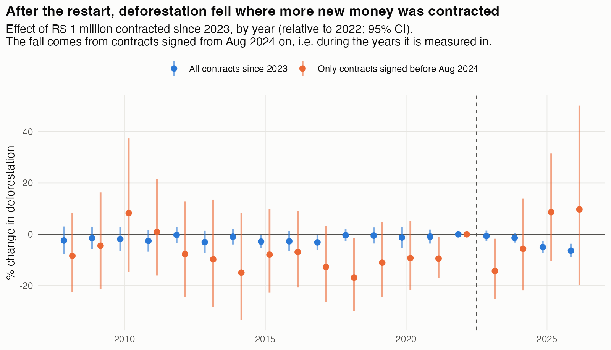
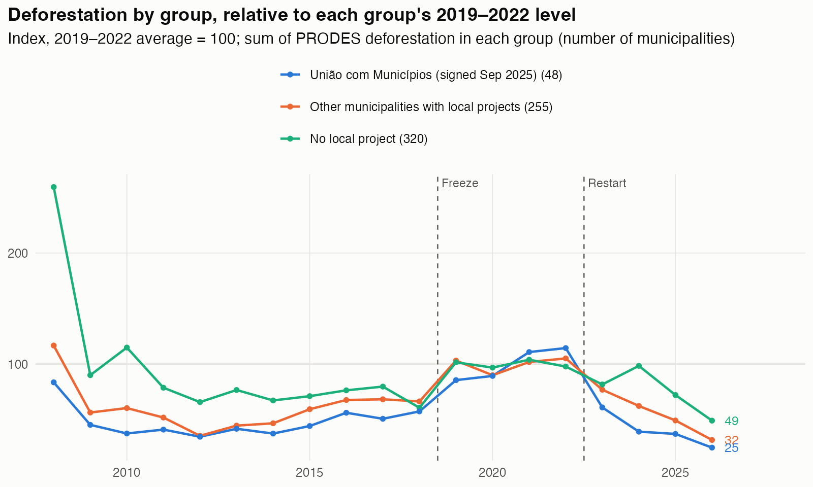
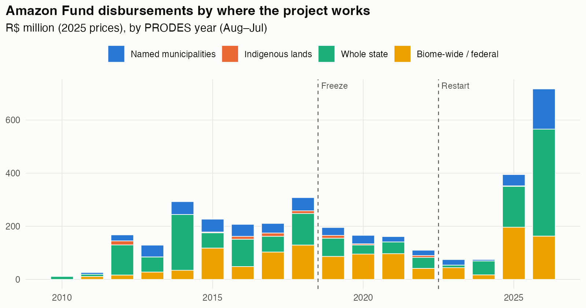
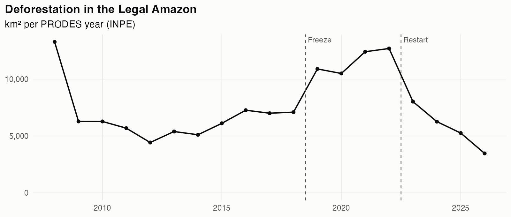
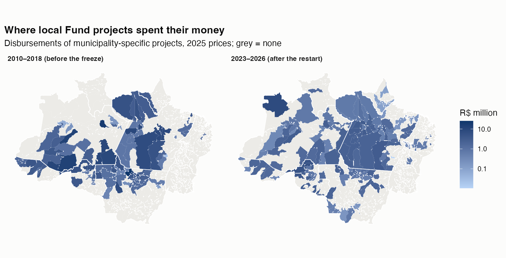
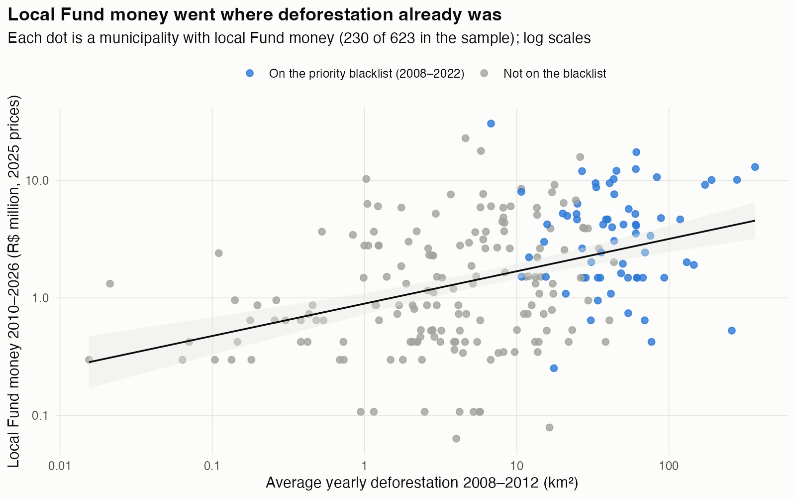

# The Amazon Fund and Deforestation

**Did Amazon Fund money reduce deforestation in the municipalities where it was spent?**

The [Amazon Fund](https://www.amazonfund.gov.br/en/home/) (Fundo Amazônia) is one of the largest results-based forest finance programmes. It has disbursed about R$ 2.9 billion since 2010, mostly donated by Norway and Germany and managed by Brazil's development bank BNDES. It was frozen in 2019, when the federal government dissolved its governance committees, and restarted in 2023. That makes the Fund a rare policy with both a long track record and two sharp, nationally imposed breaks.

This started as my seminar paper in the second semester of my economics bachelor at LMU Munich (summer 2021). In 2026 I rebuilt it from scratch, with new data through 2026 and a design that uses the freeze and the restart.

## Main finding

**After the 2023 restart, deforestation fell in municipalities that contracted more new Fund money.** Each R$ 1 million contracted since 2023 is associated with about **5 % less deforestation in 2025 and 6 % in 2026**, relative to 2022 (t ≈ −4 for both; 2024: −1 %, not significant). The comparison is within the same state and year, and it controls for each municipality's blacklist status by year, so it holds fixed everything that changed for the whole Amazon, a whole state or the priority municipalities at the same time.

**The big caveat is timing.** The decline comes entirely from contracts signed **from August 2024 on**, mostly the R$ 150 million *União com Municípios* programme, which explicitly targets priority municipalities and was signed only in September 2025. Those contracts were signed *during or after* the years in which the decline is measured, so the money may have followed falling deforestation rather than caused it. Counting only contracts signed before August 2024 (orange in the figure), the effect disappears (+8 % in 2025, +9 % in 2026, not significant). The pre-2022 coefficients are also all negative (2015 and 2017 individually significant), so exposed municipalities were already on a rising path before the restart. Treat this as the most interesting pattern in the data, not as proof. The 2027 PRODES data will show whether the União municipalities keep diverging.

**How fragile is it?** A sensitivity analysis (Rambachan & Roth 2023, [figure](figures/10_restart_sensitivity.png)) asks how much the post-2022 trend may deviate from parallel, relative to the largest year-to-year swing seen before. The 2025 and 2026 effects stay significant only up to **Mbar = 0.25**, i.e. if post-period deviations are at most a quarter of the worst pre-period swing; at Mbar = 0.5 the interval already includes zero. The usual benchmark is Mbar = 1, so the result is fragile.

**Synthetic DiD on the União municipalities** (Arkhangelsky et al. 2021; [results](results/synthdid_uniao.csv)) builds a weighted comparison group that matches their deforestation path before 2024. Against **other blacklisted municipalities**, which are the comparable group (large, active frontiers), the União municipalities show **no difference after 2024** (+3.5 %, t = 0.2): their decline is matched by similar municipalities without the programme. Against all other municipalities the estimate is even positive (+45 %), but that comparison is distorted: the donors are mostly tiny municipalities whose deforestation fell to almost zero, which looks like a huge decline on a log scale.

The same pattern is visible without any model. União municipalities had deforestation peaks above the other groups in 2021–2022, and they were already falling faster from 2023, two years before their contract was signed:

### The rest of the picture

| Question | Design | Result |
|---|---|---|
| Does more money in a year mean less deforestation the next year? | Fixed effects, municipality + state × year | No. +5 % per R$ 1 million (p = 0.15). None of 20 robustness variants is significantly negative; with a two-year lag the association is significantly *positive* (+12 %, p < 0.001), consistent with money following deforestation ([figure](figures/07_dose_response_robustness.png)) |
| What happens after a municipality gets its first local project? | Staggered DiD (Callaway & Sant'Anna) | Deforestation keeps rising relative to not-yet-treated municipalities (+0.35 log points on average; [figure](figures/05_first_project_event_study.png)). The most plausible reading is *targeting* (projects go to active frontiers), though the design can't separate it from an effect |
| Did deforestation rise where Fund money dried up in the 2019 freeze? | Event study on each municipality's money shortfall | No detectable rise ([figure](figures/06_freeze_event_study.png)), and the pre-period is not clean (2008, 2009 and 2017 significantly negative). Payments on existing contracts continued through 2019–2022; only new contracts stopped |
| Does local Fund money bring more enforcement? | IBAMA flora fines as outcome | No effect |

Taken together: local Fund money was **not** allocated at random. It followed deforestation, which is why naive comparisons (including my own in 2021) find a positive association. The restart is the most promising source of variation, but so far its timing doesn't allow a causal reading.

## Where the money went

Only about **23 % of contracted Fund support** (19 % of the money disbursed so far) went to projects that name the municipalities or indigenous lands where they work. The estimates above concern that local money. State programmes (30 % of contracted support) and biome-wide or federal programmes (46 %, e.g. IBAMA enforcement and satellite monitoring) can't be tied to municipalities. They're absorbed by the state × year fixed effects.

Local money was not spread evenly: municipalities that were already clearing more forest in 2008–2012 received more of it (correlation 0.41 on log scales across the 230 municipalities with local money). Most of the biggest recipients were on the federal priority blacklist. This targeting is why naive comparisons find a positive association between Fund money and deforestation.

## Then and now

| | 2021 seminar paper | 2026 rebuild |
|---|---|---|
| Data | Spreadsheets copied by hand from the Fund's website, PRODES export 2008–2020 | Everything downloaded by script: all 156 project pages with 644 dated disbursements (they sum exactly to the Fund's published R$ 2,926 million), PRODES through 2026 |
| Treatment | "Has a project": binary, no intensity | R$ per municipality per year (2025 prices), plus freeze and restart exposure |
| Method | Two-way fixed effects (`plm`), plain staggered DiD | `fixest` with state × year fixed effects, Callaway–Sant'Anna for staggered adoption, event studies around the freeze and restart |
| Code | One 1,800-line exploratory script | Small tested functions (96 unit tests), one entry point, about 40 seconds end to end |

The 2021 version is preserved under the tag [`v2021-seminar`](../../tree/v2021-seminar) and as a PDF in [`archive/2021/`](archive/2021/The_Amazon_Fund_2021.pdf).

## Data

| Source | What | How |
|---|---|---|
| [INPE PRODES / TerraBrasilis](https://terrabrasilis.dpi.inpe.br) | Annual deforestation per municipality, 2008–2026; indigenous-land polygons | JSON files behind the official dashboard (updated 2026-10-16) |
| [Fundo Amazônia](https://www.fundoamazonia.gov.br/pt/projetos-apoiados/) | 156 projects: values, dates, territorial coverage, every disbursement | Scraped project pages (cached in `data/raw/`) |
| [BNDES open data](https://dadosabertos.bndes.gov.br/dataset/operacoes-financiamento) | The Fund's 163 contracts | Cross-check of the scraped list |
| [Seixas (2023), Zenodo](https://doi.org/10.5281/zenodo.8412144) | Priority-municipality blacklist 2008–2022, with the MMA portaria per entry | Download |
| [IBAMA open data](https://dadosabertos.ibama.gov.br/dataset/fiscalizacao-auto-de-infracao) | Environmental infractions (flora) per municipality | Download (aggregated; the raw file is not committed) |
| IBGE (SIDRA tables 1612, 3939; `geobr`) | Crop areas and prices, cattle herds, municipal boundaries | API |
| BCB, FRED | IPCA inflation, USD/BRL, global beef price | API |

Which municipalities a project covers is matched automatically from the project's text. A small, cited corrections file ([`data/manual/coverage_overrides.csv`](data/manual/coverage_overrides.csv)) fixes the rest; the review is documented in [`docs/manual_review.md`](docs/manual_review.md).

## Running it

Requires R ≥ 4.5 with `tidyverse`, `fixest`, `did`, `sf`, `geobr`, `httr2`, `rvest`, `jsonlite` and `testthat`; for the slow checks also `HonestDiD` (CRAN) and `synthdid` (`remotes::install_github("synth-inference/synthdid")`).

- **RStudio:** open `amazon-fund-deforestation.Rproj` and source `run_all.R`.
- **Terminal:** `Rscript run_all.R` from the repo root.

The slow checks (HonestDiD bounds and synthetic DiD, ~15 min) only rerun with `SENSITIVITY <- TRUE`; their results are committed in `results/`. Raw downloads are cached in `data/raw/` (all committed except the 123 MB IBAMA file, which is downloaded on the first run), so later runs work offline; set `REFRESH <- TRUE` in `run_all.R` to fetch fresh data. Run the tests with `Rscript tests/testthat.R`.

| Folder | Contents |
|---|---|
| `R/` | One file per step: `prodes.R`, `fund_scrape.R`, `fund_coverage.R`, `priority.R`, `controls.R`, `panel.R`, `estimate.R`, `report.R` |
| `data/raw/`, `data/manual/` | Cached downloads and the two hand-maintained inputs |
| `figures/`, `results/` | Figures and coefficient tables produced by `run_all.R` |
| `docs/` | Research design ([`design.md`](docs/design.md)) and manual-review notes |

## What this can and cannot say

- **It covers local projects only** (about 23 % of contracted support). Money is in prices of PRODES year 2025 (Aug 2024–Jul 2025). The effect of the Fund as a whole, including federal enforcement it financed, is absorbed by the year and state × year effects and can't be estimated this way.
- **Missing controls.** There are no weather controls: free sources would have needed far more downloading than the state × year effects justify. PRODES doesn't publish cloud cover per municipality. The cattle price index starts in 2010, so it enters only as a robustness check.
- **The blacklist after 2022 is carried forward** from the last list with a free, machine-readable source. The restart estimates control for blacklist status by year, but the 2023 and 2024 lists (Portarias MMA 834/2023 and 1.202/2024) are still missing.
- Two staggered-adoption cohorts (2013, 2017) are small.
- **Provisional:** the manual coverage review awaits a spot-check.

## Next steps

1. Add the official 2023/2024 priority-municipality lists, and re-estimate the restart once PRODES 2027 is out: the test of whether the União municipalities keep diverging.
2. A shift-share instrument for Fund money (national donation inflows × predetermined local exposure).
3. Possibly a new paper reporting the results.
